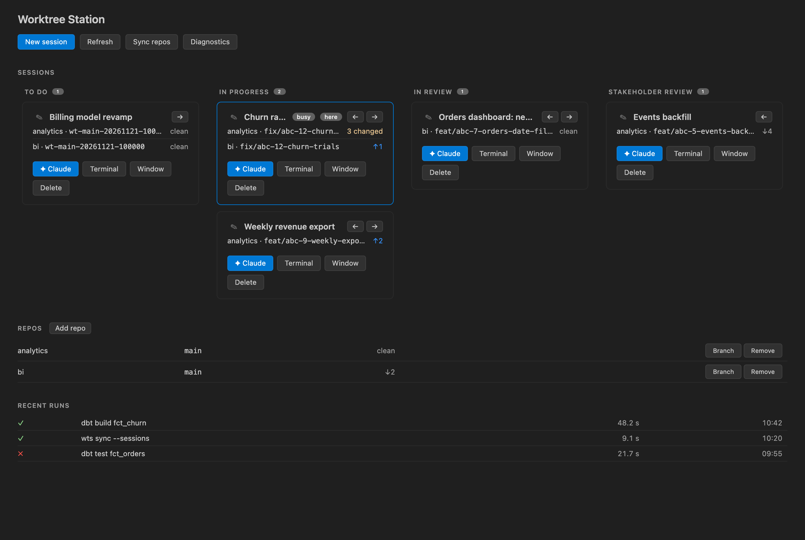

# Worktree Station

[](LICENSE)

A development environment built for working alongside Claude Code: one command
(or one click) gives you an isolated **session** a git worktree per repo,
opened together in VS Code, with its own Claude Code rooted in it. Run several
sessions in parallel, track them on a kanban, throw them away when done.



_Fictional data; regenerate with `npm run screenshot` in `vscode-extension/worktree-station`._

It is made of three pieces, all in this repo:

- **`wts`**, a zsh CLI that creates and cleans sessions and manages the repo list;
- **Worktree Station**, a VS Code extension that puts a dashboard on top of `wts`;
- **agent control**: every session action is also a `wts` command, so a
  supervising Claude Code session can drive the others (see
  [Driving sessions from an agent](#driving-sessions-from-an-agent));
- the **dotfiles** around them: shell, VS Code settings, shortcuts, Claude Code
  hook wiring. New machine: `git clone && ./install.sh`.

Nothing is tied to a stack or a trade: any set of git repos works.

## Installation

```bash
git clone git@github.com:TEC0R/worktree-station.git ~/.dotfiles
~/.dotfiles/install.sh --dry-run   # shows what will change
~/.dotfiles/install.sh
exec zsh
wts repo add https://github.com/you/your-repo   # declare your first repo
```

`install.sh` is idempotent: it backs up every real file it replaces as
`<name>.backup-<timestamp>` and leaves an already-correct symlink alone.

### What it sets up

| Target | Source |
|---|---|
| `~/.zshrc` | `zsh/zshrc` → loads `zsh/[0-9][0-9]-*.zsh` in order |
| `~/Library/Application Support/Code/User/settings.json` | `vscode/settings.json` |
| …/`keybindings.json` | `vscode/keybindings.json` |
| …/`tasks.json` | `vscode/tasks.json` (**user** tasks, valid in any worktree) |
| …/`snippets/*.code-snippets` | `vscode/snippets/` |
| `~/.claude/settings.json` | `PostToolUse` (dbt conventions) and `Notification` (wts inbox) hooks and `"outputStyle": "Concise"` merged in, never replaced (a style already chosen in `/config` is kept) |
| `~/.claude/scripts/replay_progress.py` | `claude/scripts/replay_progress.py`: progress bar of a headless data-agency replay (`python3 -I ~/.claude/scripts/replay_progress.py <stream.jsonl> --follow`) |
| `~/.config/wts/secrets.env` | created empty, `chmod 600` |
| `Worktree Station` VS Code extension | `vscode-extension/worktree-station/`, built then installed |
| `~/Library/LaunchAgents/com.tec0r.claude-update.plist` | **opt-in** (`--claude-stable`): `launchd/com.tec0r.claude-update.plist`, **copied** (launchd does not reliably load symlinked agents at login) |

### Claude Code on the stable channel (opt-in)

Off by default: it changes how Claude Code updates on your machine. To turn it
on:

```bash
~/.dotfiles/install.sh --claude-stable
```

At every login, `bin/claude-update-stable` then runs `claude install stable`, then
installs the `anthropic.claude-code` VS Code extension at **the exact version the
CLI ended up on**. Installing a specific version pins the extension, so VS Code
stops bumping it to latest and both stay aligned. `autoUpdates` stays `false` in
`~/.claude.json`, otherwise the CLI's own updater would move it to latest between
logins.

```bash
claude-update-stable                 # update now
tail ~/Library/Logs/claude-update.log
```

A notification appears when the version changes (reload VS Code windows to use
it) or when the update fails; nothing when already up to date.

`vscode/worktree-station.code-profile` is a portable export of the same VS Code
setup (new machine, onboarding), regenerated by `wts profile build`.

### Installing the extension alone

`install.sh` already builds and installs it. To rebuild it after changing its
code:

```bash
cd ~/.dotfiles/vscode-extension/worktree-station
npm install                                          # first time only
npm run package                                      # → worktree-station.vsix
code --install-extension worktree-station.vsix --force
```

Then `⇧⌘P` → *Developer: Reload Window*: VS Code does not reload an extension on
its own. During development, `npm run watch` rebuilds on every save.

Its identifier is **`tec0r.worktree-station`**. The `.vsix` is a build artifact,
excluded by `.gitignore`. To share the extension without the repo, send the
`.vsix` (*Extensions: Install from VSIX…*); it needs `wts` on the `PATH`, since
the extension reimplements nothing and calls the CLI.

Uninstalling (`code --uninstall-extension tec0r.worktree-station`) wipes its
`globalState`: run history is lost. Kanban columns and session names live in
`~/.config/wts/state.json` and survive.

## Configuration

| File | Content |
|---|---|
| `~/.config/wts/repos` | the repo list, managed by `wts repo` / the dashboard (see [Repos](#repos)) |
| `~/.config/wts/config.sh` | optional machine-specific overrides, loaded before the defaults of `lib/config.sh`: `WTS_ROOT` (where clones live, `~` by default), `WTS_WORKTREE_DIR` (`~/worktrees`), `WTS_VENV`, personal shell functions… |
| `~/.config/wts/state.json` | kanban columns, the column of each session and session names, shared by the dashboard, `wts card` / `name` / `columns` and any agent (see [Driving sessions from an agent](#driving-sessions-from-an-agent)) |
| `~/.config/wts/inbox.jsonl` | Claude Code sessions waiting on a human, one JSON line per notification |
| `~/.config/wts/secrets.env` | tokens and keys, `chmod 600`, loaded at shell startup; a file with wider permissions is refused with a warning |

Nothing sensitive or machine-specific lives in this repo.

## Sessions

A session is one worktree per selected repo, named `<repo>-<branch>-<timestamp>`
on a `wt-<branch>-<timestamp>` branch, plus a multi-root `.code-workspace`
opening them together.

**New session** (`⌃⌥N`, dashboard or side bar) first asks for the repos (all
checked by default), then, for each one, the starting branch: remote branches,
most recent first, the default one on top. The list updates after a background
`fetch`, and a name missing from it can be typed. With a single declared repo,
the repo step is skipped.

From the terminal:

```sh
wts wt                              # every repo, on its default branch, opens VS Code
wts wt feat/x main                  # every repo, branches positional (declaration order)
wts wt --repo api:feat/x            # only these repos (repeatable), branch optional
wts wt --no-open [...]              # create without opening VS Code
wts wt ws <timestamp>               # regenerate a session's .code-workspace
```

Positional branches and `--repo` cannot be mixed.

### Cleanup

Creating a session never deletes older ones: their worktrees and kanban cards
stay. Cleanup is explicit:

```sh
wts wt list                  # status of every worktree (busy / removable)
wts wt clean [hours] [--force]
wts wt rm <path>             # one worktree; its wt-* branch stays
wts up                       # sync every repo + clean idle worktrees
```

A worktree is never deleted if it carries uncommitted changes, unpushed
commits, or a file touched in the last 8 hours (unless `--force`).

## Repos

**Add repo** (dashboard or Repos view) offers three sources:

- **GitHub link**: clones the repo (through `gh`, so private repos work) into
  the given folder, `~/<repo>` by default. An existing clone of the same repo is
  reused; an existing non-empty folder is used as the parent folder;
- **folder on disk**: any git clone, wherever it lives;
- **clone already in `~`**: list of the clones not declared yet.

Then **Branch** / **Remove** on each row, and a single **Sync repos** at the top
(`pull --ff-only` + deletion of merged branches, for every repo, then the
rebase of every session's worktrees onto `origin/<base>`). A worktree with
uncommitted changes is skipped; a conflict aborts its rebase and leaves it
untouched. A branch already on GitHub is then pushed (`--force-with-lease`) so
its PR is up to date too — unless GitHub holds commits missing locally (a
colleague's push, GitHub's *Update branch*), in which case it is left alone. The
base branch (`staging`, `master`…) is never rebased nor pushed: a `wt-<base>-*`
branch that still tracks `origin/<base>` stays local.
From the terminal:

```sh
wts repo                                                 # list
wts repo add https://github.com/org/repo [--dest ~/code] # clone + declare
wts repo add ~/code/my-repo [main] [type]                # existing clone
wts repo add my-repo                                     # = ~/my-repo
wts repo base my-repo develop                            # default branch
wts repo rm my-repo                                      # remove, nothing deleted from disk
wts sync [repo]                                          # sync one or every repo
wts sync --sessions                                      # every repo, then every session
```

The branch is detected from `origin/HEAD` when omitted. `~/.config/wts/repos`
holds one `<name>:<branch>:<type>[:<path>]` line per repo, the path being
written only outside `~/<name>`. Two repos cannot share the same folder name.

## The dashboard

`⌃⌥E` opens the **Worktree Station** dashboard as an editor tab: sessions as a
kanban (**Preparation / In progress / UAT** by default, any list set by
`wts columns`), then the repos and the latest runs. Only columns holding a card
are drawn, and they wrap onto a new row rather than scroll sideways.

- A card moves by drag and drop or with its `←` `→` arrows, and is renamed by
  double-clicking its title (or with its pencil). Column and name live in
  `~/.config/wts/state.json`, shared by every window and by the CLI; a change
  from outside (`wts card`, an agent) shows up at once. A session starts in the
  first column and
  only leaves it when moved: git state says what is on disk, not where the work
  stands. A cleared name falls back to the timestamp.
- A card's title says what its Claude does **now**: **working** (pulsing dot) while
  it runs a turn, **waiting** when it needs a permission or an answer, nothing once
  the turn is over. Written by the Claude Code hook `claude/hooks/activity.py`
  (installed by `install.sh`) to `~/.config/wts/activity.json`, in every mode
  (terminal, panel, background). Unpushed work no longer shows there: it still
  blocks deletion and shows in the sidebar.
- Card buttons follow `worktreeStation.claudeMode`: **✦ Claude**, Terminal,
  Window, Delete in `terminal` mode; **Window**, Terminal, Delete in `window`
  mode. *Terminal* asks which repo when the session has several.
- *Terminal* (card or sidebar) then asks which Python environment to activate
  when one exists: a `.venv` / `venv` / `env` / `*_venv` folder of the worktree
  or of the repo's main checkout (an untracked venv is not copied into a
  worktree), the worktree's pipenv virtualenv, or `WTS_VENV`. *No environment*,
  last and set apart, opens a plain shell with nothing activated; with no
  environment found the terminal opens directly. Each environment gets its own
  terminal, `<worktree> · <env>`.
- It opens at startup according to `worktreeStation.dashboardOnStartup`:
  `never`, `known` (default — only when the window contains a declared repo, so
  never in a session window) or `always`.

The **side bar** (`⌃⌥⇧E`) gives the same information in tree form — Sessions,
Repos, Latest runs — for a quick glance. Every button of the dashboard calls a
command the side bar already has; state is read through
`wts api sessions|repos|config` (JSON) and actions run as real VS Code tasks, so
their output stays in the Terminal panel and stays interruptible.

## Several sessions, one window

From the **Sessions** panel, "Load into this window" adds a session's folders to
the current multi-root workspace without reloading it. Each folder keeps its own
git repo and its own terminal. Turning a **single-folder** window into a
multi-root one does reload the extension host; the extension warns first.
Starting from a session (or a `.code-workspace`) avoids it.

Creating a session does not open it: the notification offers **Load here**, plus
**Claude terminal** (`claudeMode: terminal`) or **New window**
(`claudeMode: window`). Ignoring it leaves the current window untouched.
`worktreeStation.attachOnCreate: true` loads it right away.

One Claude per session at a time: before starting one (✦ Claude, the window's
Claude panel, `wts claude`, a worktree's Claude), the extension reads Claude
Code's `~/.claude/sessions/<pid>.json` and, when a live process already has its
cwd in a worktree of the session, shows that session's window with a notice
instead of starting a second one. A restored window whose Claude tab is already
open does not open another either.

### Deleting a session closes its windows

VS Code offers no API to drive another window, so the extension keeps a registry
in `~/.config/wts/windows/`: one `<pid>.json` per window listing its
`.code-workspace` and folders, refreshed every 30 s (stale after 90 s). Deleting
a session:

1. looks for the other windows holding one of its worktrees — the confirmation
   says how many will close;
2. drops a `close-<pid>.request` each window watches for itself, triggering
   `workbench.action.closeWindow` (unsaved editors are respected);
3. deletes the worktrees, then the `.code-workspace`;
4. closes the current window last, if it held the session.

A worktree removed outside the panel (`wts wt clean`, `git worktree remove`) is
detected by each window: when *all* its folders are gone, it offers to close.
Setting: `worktreeStation.closeWindowOnDelete` (`true` by default).

## One Claude Code per session

The cwd of a Claude Code **panel** conversation is always
`workspaceFolders[0]`, and no contributed command accepts another one. In a
multi-root window, every panel conversation therefore shares a single root.

The **terminal** accepts any cwd, and Claude Code's IDE integration is per
window (`~/.claude/ide/<pid>.lock`, and `CLAUDE_CODE_SSE_PORT` injected into
every terminal of the window). A `claude` started in a terminal of that window
attaches to it: diffs in the editor, `@`-mentions, current selection. Hence the
✦ button:

```sh
# what the button runs, cwd = the session's first worktree
claude --add-dir '<every other worktree of the session>'
```

`wts claude --brief <file> <session>` starts it with the file's text as its first
message:

```sh
# what the terminal runs; `--` keeps --add-dir from taking the brief for a folder
claude --add-dir '<other worktrees>' -- "$(cat '<home>/.config/wts/briefs/used/<session>-<token>.md')"
```

In `window` mode the brief starts Claude in a terminal of the session's window, not in
its panel: the Claude Code panel accepts a starting prompt but only pre-fills its input
with it, so the brief would never be sent. When Claude already runs in the session (a
panel in any window included), the brief is refused with an error and never typed into
that conversation; the file stays in `briefs/used/`.

`wts claude --background --brief <file> <session>` starts the same Claude for another
Claude session (a supervising one, say) that reaches it through `SendMessage`. The brief
is required there: a Claude started for someone else and left without its first message
sits idle with no one watching. In `terminal` mode it runs in a **hidden** terminal of
the current window: no window opens, and the session's ✦ button then shows that
terminal instead of starting a second Claude, so a permission prompt can be answered
there. Closing the window stops it. In `window` mode it opens the session's window with
Claude in a terminal there, as above.

Any web page can open a `vscode://` link, so the link never carries the brief's path:
`wts` copies the file (mode `600`) to `~/.config/wts/briefs/pending/<session>-<token>.md`
and passes only the random token. The extension reads briefs from that folder alone and
moves each one to `briefs/used/` on first use, so a token works once.

`wts` then waits up to 15 s (`WTS_BRIEF_WAIT`) for that move. Without it, it removes the
brief from `pending/` and exits with an error: the link reached no window able to read it,
typically a window opened before the extension was last installed, which runs the older
code until it is reloaded. A refusal (Claude already running) still counts as picked up and
shows only as a VS Code notification.

When the worktree already has a Claude conversation, the button adds `--continue`
and reopens it, so Claude keeps what it learned on that session; a brief then arrives
as the next message of that conversation (unless
`worktreeStation.claudeArgs` already picks a conversation). The panel does the same
through `claude-vscode.editor.openLast`.

One conversation per session, rooted in the right worktree — so the right
`CLAUDE.md`, `.claude/skills/` and hooks — with read/write access to the
session's other repos. Several sessions = several Claude terminals side by side.
`⌃⌥J` does the same for the session of the open file.

`worktreeStation.claudeMode` picks the default:

| Value | Effect |
|---|---|
| `terminal` (default) | Claude in a terminal of the current window. Several sessions in parallel. New session offers **Claude terminal** |
| `window` | the session opens in its own window, where the Claude panel is correctly rooted. One window per session. New session offers **New window** |

Whatever the mode, right-clicking a session offers **"Claude Code (panel,
dedicated window)"**: the window opens on that session alone and the Claude
panel opens there on its own (handoff through the shared `globalState`, then
`claude-vscode.editor.openLast`). If it does not, `⌘⇧Esc` opens the panel.

Related settings: `worktreeStation.claudePath`, `worktreeStation.claudeArgs`.

## Driving sessions from an agent

Everything a card does can be done from a shell, so a supervising Claude Code
session (or a script) can run the other sessions without clicking:

```sh
wts claude 20261125-110907        # open Claude Code on that session (claudeMode applies)
wts claude --brief brief.md 20261125-110907  # same, brief.md sent as Claude's first message
wts claude --background --brief brief.md 20261125-110907  # for a supervising Claude, brief required: hidden terminal (terminal mode) or window (window mode)
wts claude-close 20261125-110907  # close its Claude terminal
wts claude-panel 20261125-110907  # the session alone in a window, Claude panel open
wts open 20261125-110907          # open the session in its own window
wts rm 20261125-110907            # delete it: worktrees, windows, card (--force if work is unpushed)
wts card 20261125-110907 wip      # move its card
wts name 20261125-110907 "billing revamp"
wts columns todo="To Do" doing="In Progress" review="In Review"
wts state                         # columns, cards and names as JSON
wts inbox                         # sessions waiting on a human; --json, --clear
```

`claude`, `claude-close`, `claude-panel` and `open` go through the extension's URL handler
(`vscode://tec0r.worktree-station/<action>?session=<id>[&brief=<token>]`; `WTS_VSCODE_SCHEME`
picks another editor build): VS Code routes the link to its last focused
window. `rm` stays in the shell on purpose (any web page can open a `vscode://`
link): it refuses a session holding uncommitted or unpushed work unless `--force`,
asks the windows open on the session to close, then deletes its worktrees, its
`.code-workspace` and its card. `card`, `name` and `columns` write `state.json`
atomically. A card whose
column disappears falls back to the first column.

The inbox is fed by a Claude Code **Notification** hook
(`claude/hooks/notify-inbox.py`, installed by `install.sh`): whenever a session
asks for a permission or waits for input, a line with the session timestamp,
the folder and the message is appended. Each worktree session can then be
messaged by its folder name from the supervising session (`SendMessage`), and
only the questions a human must answer come back up.

## Shortcuts

`ctrl+alt` prefix, free on macOS:

| Key | Action |
|---|---|
| `⌃⌥E` | Worktree Station dashboard |
| `⌃⌥⇧E` | Worktree Station side bar |
| `⌃⌥N` | new session |
| `⌃⌥J` | Claude Code on the current session |
| `⌃⌥W` | worktree status |
| `⌃⌥X` | kill every terminal |
| `⌘⇧F12` | stop the running task |

`wts help` lists every CLI command; `wts doctor` checks the whole setup.

## Contributing

Issues and pull requests are welcome: read [CONTRIBUTING.md](CONTRIBUTING.md)
and the [Code of Conduct](CODE_OF_CONDUCT.md) first. Security issues go through
[SECURITY.md](SECURITY.md), never a public issue.

## License

Copyright (C) 2026 Terry Cornelusse.

Worktree Station is free software, licensed under the
[GNU Affero General Public License v3.0 only](LICENSE) (`AGPL-3.0-only`). You
may use, study, modify and share it, provided that any copy or derivative work
— including one offered as a network service — keeps this copyright notice and
is released under the same license, with its source code.
